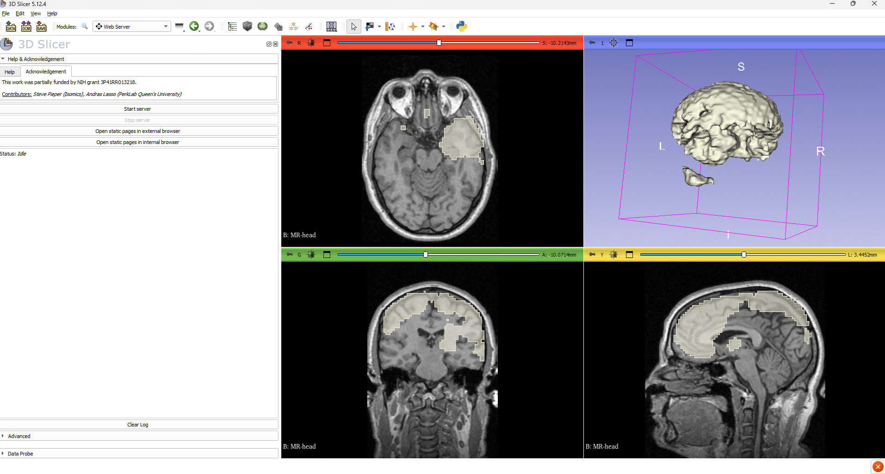

# 3D Slicer


## Overview

#### Service Offering

Glasgow TRE can provide workstations with **3D Slicer**, an open-source medical image computing, 3D visualization, and AI-assisted anatomical segmentation platform for clinical and biomedical imaging research. Researchers can inspect DICOM studies, perform manual and semi-automated 3D volume segmentation, run deep learning inference (`TotalSegmentator` and `nnU-Net`), and calculate quantitative comparison metrics entirely offline within the secure environment.



#### Version & Pre-Configured Environment

Workstations provisioned with **3D Slicer 5.12.4** (revision `34645`, 64-bit) arrive **fully pre-configured out of the box**:

- **Pre-installed AI & Segmentation Extensions**:<br>
    All core extensions and their embedded Python dependencies (`PyTorch 2.14.1+cu130`, `torchvision`, `nnunetv2`, `totalsegmentator`, `nibabel`, `dicom2nifti`) are pre-installed for GPU-accelerated execution.
- **Pre-configured Light Model Weights**:<br>
    Workstations are pre-seeded and pre-configured to use the **light (`fast`, 3 mm) pretrained model weights** (`Dataset297_TotalSegmentator_total_3mm_1559subj`), stored locally in `C:\ProgramData\TotalSegmentator\weights`. Both the **TotalSegmentator** and **nnUNet** modules automatically point to these weights at startup without requiring manual downloads or configuration.

- **Offline Operation**: <br>
    Glasgow TRE has no external internet access. Automatic update checks, the online Extensions Manager, and external sample data downloads are disabled by policy.

---

## Recommended Workstation Specifications

Medical volume rendering and 3D deep learning segmentation are memory- and compute-intensive. For optimal performance, 3D Slicer and its bundled AI extensions work best on a workstation configured with:

| Resource | Recommended Specification | Notes |
| :--- | :--- | :--- |
| **System Memory (RAM)** | **32 GB** | Required for loading multi-series 3D DICOM/NIfTI volumes and running `nnU-Net` preprocessing workers in parallel. |
| **Processor (vCPU)** | **8 CPUs** | Accelerates image resampling, marching cubes surface generation, and NIfTI export. |
| **GPU Memory (VRAM)** | **At least 4 GB GPU** (**8 GB+ GPU** for normal full-resolution segmentations) | **4 GB VRAM** is sufficient for pre-configured **light/fast (3 mm)** segmentations (`Dataset297`). **8 GB or more VRAM** is required if you run **normal (1.5 mm full-resolution)** multi-part segmentations. |
| **Local System Disk (`C:`)** | **100 GB+** | Accommodates the local DICOM database cache (`%LOCALAPPDATA%`), CUDA libraries, and temporary inference volumes. |

!!! info "Requesting GPU Capacity"

    If your project requires full-resolution (`1.5 mm`) anatomical segmentation or custom high-resolution `nnU-Net` models and your workstation has a 4 GB vGPU profile, contact the TRE helpdesk to request an **8 GB+ vGPU** allocation.

---

## Bundled Extensions

Every 3D Slicer workstation includes the following pre-installed extensions:

1. **[TotalSegmentator](https://extensions.slicer.org/view/TotalSegmentator/35457/win/amd64)** — Automated whole-body CT and MRI anatomical structure segmentation powered by `nnU-Net`. Pre-configured with offline light (`3 mm`) weights in `C:\ProgramData\TotalSegmentator\weights` via the `TOTALSEG_WEIGHTS_PATH` system environment variable.
2. **[NNUNet](https://extensions.slicer.org/view/NNUNet/35457/win/amd64) (`SlicerNNUNet`)** — Deep learning biomedical segmentation framework for running custom or pre-seeded `nnU-Net v2` models directly inside Slicer. Pre-configured at startup to point to `C:/ProgramData/TotalSegmentator/weights/Dataset297_TotalSegmentator_total_3mm_1559subj/nnUNetTrainer_4000epochs_NoMirroring__nnUNetPlans__3d_fullres` on `cuda` (`fold_0`).
3. **[PyTorch](https://extensions.slicer.org/view/PyTorch/35457/win/amd64) (`SlicerPyTorch`)** — Embedded PyTorch management utility paired with `torch==2.14.1+cu130` and `torchvision==0.29.1+cu130` for NVIDIA CUDA GPU acceleration.
4. **[SegmentEditorExtraEffects](https://extensions.slicer.org/view/SegmentEditorExtraEffects/35457/win/amd64)** — Additional interactive tools in the **Segment Editor** module, including *Surface Cut*, *Draw Tube*, *Fast Marching*, *Watershed*, and *Split Volume*.
5. **[MarkupsToModel](https://extensions.slicer.org/view/MarkupsToModel/35457/win/amd64)** — Generates 3D surface models (`vtkPolyData`) from fiducial points, closed curves, and planes for surgical planning and anatomical region definition.
6. **[MONAILabel](https://extensions.slicer.org/view/MONAILabel/35457/win/amd64)** — Interactive AI-assisted annotation and active learning client for connecting to local MONAI Label inference servers.
7. **[SegmentComparison](https://extensions.slicer.org/view/SlicerRT/35457/win/amd64) (`SlicerRT`)** — Quantitative segmentation evaluation tools from the SlicerRT suite for computing **Dice Similarity Coefficient** and **Hausdorff Distance** metrics between ground-truth and predicted segmentations.

---

## Getting Started

You can launch 3D Slicer from your desktop:

- Double-click the **3D Slicer 5.12.4** shortcut on your desktop.
- By default, the shortcut starts in your project analytical workspace (`V:\`).

!!! caution "Save Outputs and Scenes to Your Project Drive (`V:\`)"

    Always save your segmented NIfTI/NRRD volumes, MRML scenes (`.mrb` / `.mrml`), and exported tables to your project drive (`V:\<project-name>\`). The local `C:` drive (including the local DICOM cache) is not backed up across sessions.

---

## How-To Guides

### Import and inspect DICOM studies

1. Click the **DCM** (**DICOM**) button in the top toolbar.
2. Click **Import DICOM files**, browse to your study folder on `V:\`, and click **Import**.
3. Select the imported patient/study in the DICOM browser and click **Examine** then **Load**.

!!! tip "Local DICOM Database for Fast Indexing"

    3D Slicer is pre-configured to store its SQLite DICOM index locally at `C:\Users\<username>\AppData\Local\slicer.org\DICOMDatabase` so indexing remains fast and avoids network file-locking issues. Keep your raw imaging datasets on `V:\`.

### Run automated segmentation with TotalSegmentator

1. Load your CT or MRI volume into Slicer from `V:\`.
2. Open the **Modules** dropdown menu and select **Segmentation → TotalSegmentator**.
3. Select your loaded scan as the **Input volume**.
4. Ensure the **Fast (3mm)** checkbox is ticked (workstations come pre-configured with the light `3 mm` model weights).
5. Create a new **Output segmentation** node and click **Apply**.
6. On a workstation with a 4 GB+ NVIDIA GPU, fast whole-body segmentation completes in approximately 20–30 seconds.

### Run inference with the nnUNet module

1. Load your input volume into Slicer.
2. Open **Modules → Segmentation → nnUNet**.
3. Under **nnUNet Run Settings**, the module is already pre-configured with:
   - **Model path**: `C:/ProgramData/TotalSegmentator/weights/Dataset297_TotalSegmentator_total_3mm_1559subj/nnUNetTrainer_4000epochs_NoMirroring__nnUNetPlans__3d_fullres`
   - **Device**: `cuda`
   - **Folds**: `0`
   - **Checkpoint name**: `checkpoint_final.pth`
4. Select your **Input volume** and click **Apply**.
5. If you bring your own custom trained `nnU-Net` weights on `V:\`, click the `...` button next to **Model path** and select the folder containing your model's `dataset.json`, `plans.json`, and `fold_<N>` directory.

### Compare two segmentations (Dice & Hausdorff metrics)

1. Open **Modules → Radiotherapy → Segment Comparison** (provided by `SlicerRT`).
2. Select your reference segmentation and the segmentation to compare.
3. Choose an output table and click **Compute Dice similarity metrics** and **Compute Hausdorff distance metrics**.

### Run headless batch processing from PowerShell

You can automate volume processing or batch segmentation scripts from **PowerShell** using `Slicer.exe` or `PythonSlicer.exe`:

```powershell
# Run a Python script inside Slicer without opening the main window
& "C:\Program Files\Slicer 5.12.4\Slicer.exe" --launcher-no-splash --no-main-window --python-script "V:\my-project\scripts\batch_segment.py"
```

---

## Settings and Troubleshooting

- **Settings roam across workstations**: <br>
Your module preferences and UI settings in `%APPDATA%\slicer.org` follow your user profile, while large pretrained weights (`C:\ProgramData\TotalSegmentator\weights`) and the DICOM SQLite database (`%LOCALAPPDATA%`) stay on fast local storage.
- **Out of GPU memory (`CUDA out of memory`)**:<br>
 Close unused 3D views, enable the **Fast (3mm)** option in TotalSegmentator, or request an **8 GB+ vGPU** profile if running full-resolution (`1.5 mm`) segmentations.
- **Need an additional extension or pretrained model?**<br>
 Because workstations operate offline, extensions and Python wheels cannot be installed from the internet. Contact the helpdesk at [tre@glasgow.com](mailto:tre@glasgow.com?subject=3D%20Slicer%20Extension%20Request) to request staging a new extension or model weight archive on the internal mirror.

---

## Related Documentation

- [Python Core](python-core.md) — Custom image analysis and tabular post-processing in Python.
- [Jupyter Notebooks](jupyter.md) — Interactive notebooks for statistical analysis of segmentation metrics.
- [Data Transfer Guidelines](../faq/data-transfer.md) — Importing imaging datasets and exporting approved research outputs.
